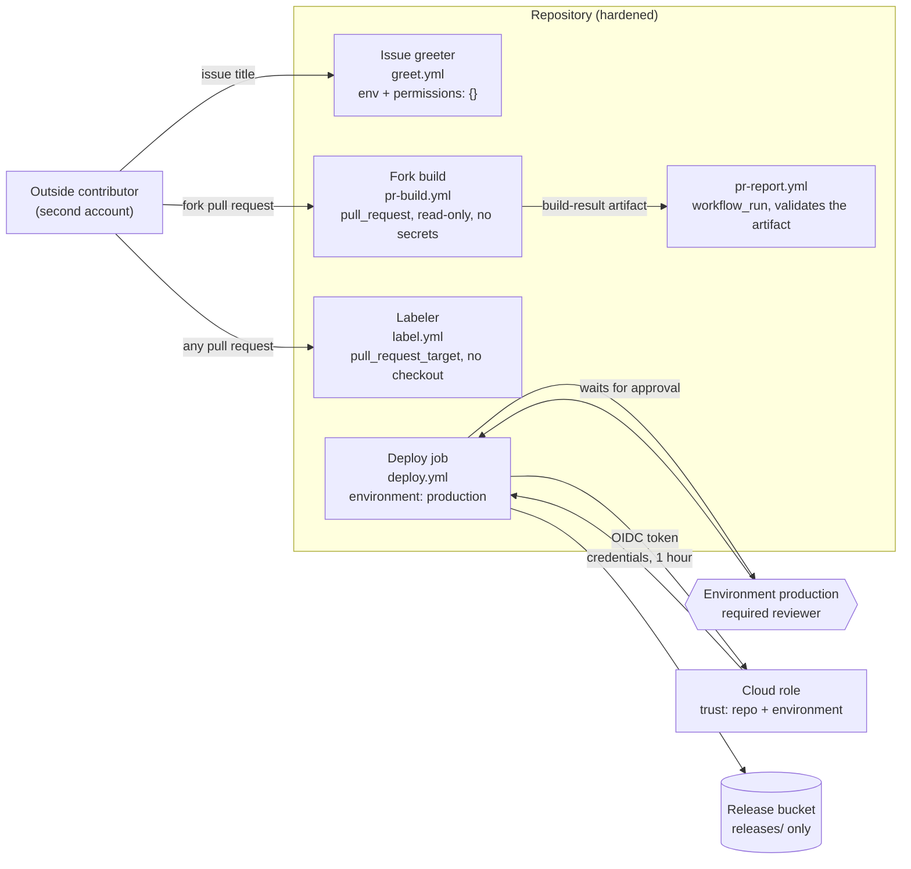

# Architecture: attack and harden

This document describes what is in this repository and why it is shaped this way. Component names match the diagram in the lesson ("Three attacks, three fixes, then OIDC"): **Outside contributor**, **Issue greeter**, **Fork build**, **Labeler**, **Deploy job** and **Cloud role**.

The repository is the **hardened** version. The three vulnerable workflows of the lesson are kept, unchanged in behavior, in [`exploit/vulnerable/`](exploit/vulnerable) as lab files, outside `.github/` so they never run on GitHub.

## Components and what each owns

| Component (lesson diagram) | Vulnerable lab file | Hardened workflow | What it owns |
| --- | --- | --- | --- |
| **Outside contributor** | [`exploit/events/`](exploit/events) | | The attacker's inputs as event payloads: an issue whose title closes a quote, a pull request from a fork. On GitHub it is a second account you own. |
| **Issue greeter** | `exploit/vulnerable/.github/workflows/greet.yml` | [`greet.yml`](.github/workflows/greet.yml) | Greets the author of a new issue. Fixed by passing the title through `env:` and giving the job `permissions: {}`. |
| **Fork build** | `.../pr-build.yml` (`pull_request_target`) | [`pr-build.yml`](.github/workflows/pr-build.yml) (`pull_request`) and [`pr-report.yml`](.github/workflows/pr-report.yml) (`workflow_run`) | Builds a pull request's code. The build runs unprivileged and uploads a result; a second, privileged workflow that never touches the fork's code posts it. |
| **Labeler** | `.../label.yml` (no `permissions`) | [`label.yml`](.github/workflows/label.yml) | The one job that needs `pull_request_target`: adding a label. No checkout, two token scopes. |
| **Deploy job** | | [`deploy.yml`](.github/workflows/deploy.yml) | Builds and uploads to S3 from the `production` environment, with an OIDC token instead of a stored key. |
| **Cloud role** | | [`infra/modules/github-oidc-role`](infra/modules/github-oidc-role) | The IAM role and its trust policy: one repository, one environment, `StringEquals` only. |
| The application | | [`src/`](src) | A small issue greeter in four layers (domain, application, infrastructure, interfaces): text a stranger typed is sanitized and printed, never run. It is what `npm run build` builds and `npm test` tests. |
| The workflow tools | | [`pipeline/`](pipeline) | `harden-lint` (the review checklist as a linter), the validated result reader and comment writer behind `pr-report`, and the model of the trust policy used by `make check-trust`. |
| The lab | | [`scripts/lab.sh`](scripts/lab.sh), [`exploit/stubs/`](exploit/stubs) | Runs the attacks on the vulnerable files and the fixes on the hardened ones with `act`, and fails unless each does what the lesson says. |
| The settings | | [`scripts/github-settings.sh`](scripts/github-settings.sh), [`scripts/set-variables.sh`](scripts/set-variables.sh) | The repository and environment settings the workflows assume, applied with `gh`. Run by hand, once. |

## Pattern: layered application, small linter, infrastructure as a tested module

The application follows the usual layering and ESLint's `no-restricted-imports` enforces it (`domain` imports nothing, `application` imports the domain, `infrastructure` and `interfaces` import below them, nothing imports `interfaces`, and `src` and `pipeline` never import each other). The pipeline tools are plain functions with injected collaborators (`fetch`, `sleep`, the comments API), so they test without a network. Terraform is two modules composed by one environment; the trust policy is built with `jsonencode` from known values so it is known at plan time, which is what lets both `terraform test` and the TypeScript model check it with no account.

## Data flow

### One run, step by step (a fork's pull request, then a deploy)

1. A stranger opens a pull request from a fork. GitHub starts the workflows listening to `pull_request` and `pull_request_target`.
2. `pr-build.yml` runs with a **read-only token and no secrets** (GitHub withholds both from fork pull requests under `pull_request`). It checks out the fork's code with `persist-credentials: false`, installs, builds and tests. Whatever the fork's build script does, there is nothing to steal and nothing to write with.
3. Its last step writes `result.json` (`{pr, sha, conclusion}`) from event values passed through `env:` and uploads it as the artifact `build-result`.
4. `label.yml` (`pull_request_target`) runs in the base repository with `pull-requests: write`. It has no checkout; the labeler reads file names through the API and adds labels.
5. When `pr-build` completes, GitHub starts `pr-report.yml` from the **default branch**. It reads the artifact as untrusted data: only an integer pull request number, a 40-character hash and one of `success`, `failure`, `cancelled` pass `parseResult`. It posts or updates one comment, retrying 5xx answers with backoff.
6. After a merge to `main`, `deploy.yml` starts and pauses: the `production` environment requires a reviewer. Nothing has asked for a token yet.
7. After approval the job requests an OIDC token. Its `sub` claim is `repo:OWNER/REPO:environment:production`. `aws-actions/configure-aws-credentials` presents it to AWS STS.
8. STS checks the signature against the account's GitHub identity provider and the two conditions of the trust policy (`aud` and `sub`, `StringEquals`). It returns credentials that expire in an hour. The role can write under `releases/` of one bucket and list that prefix, nothing else.
9. `aws s3 sync` uploads `dist/` to `releases/<commit>/`. The same job from any other branch, a pull request or a fork presents another `sub` and STS refuses before issuing anything.

## Decisions and trade-offs

**Build untrusted code and report on it in two workflows** ([ADR 0001](docs/adr/0001-build-untrusted-code-and-report-in-two-workflows.md)). The cost is a second workflow and a validated artifact. The gain: the only code that ever holds a write token is code from the default branch.

**The subject names the environment, not the branch** ([ADR 0002](docs/adr/0002-the-oidc-subject-names-the-environment.md)). A subject of `ref:refs/heads/main` can be satisfied by any job on `main`, including one a compromised dependency adds. Tying the trust to an environment ties it to the environment's protection rules: reviewers and a branch policy.

**`permissions: {}` at the top of every workflow, the minimum per job.** The repository default stays read-only too (`scripts/github-settings.sh`), but the workflow files do not depend on a setting somebody can change.

**Every action pinned to a full commit SHA** with the version in a comment, enforced by `harden-lint`, by the repository's `sha_pinning_required` setting and by Dependabot proposals.

**A custom linter beside actionlint** ([ADR 0003](docs/adr/0003-harden-lint-beside-actionlint.md)).

**Variables, not secrets, for the role ARN, region and bucket.** They are not credentials; making them secrets would only hide them in logs.

**Force-destroy on the demo bucket only.** The module defaults to `false`; the demo environment sets it so `terraform destroy` leaves nothing behind.

## Failure modes the lesson teaches, and how to reproduce each

| Failure | What you see | How to reproduce |
| --- | --- | --- |
| **Script injection** | The log has a line the `run:` step never printed on its own: the injected command's output. | `make run`, attack 1: `INJECTED-COMMAND-RAN` on its own line. `make attack-scan` shows the linters flagging the file. |
| **Fork code with a secret** | The fork's build script prints from inside the base repository's run, with `DEPLOY_TOKEN` in its environment. | `make run`, attack 2: `FORK CODE RAN: event=pull_request_target deploy-token-in-environment=true`. |
| **The same fork code, fixed** | The build still runs and reports; the secret is not in its environment. | `make run`, fix 2: `event=pull_request deploy-token-in-environment=false`. |
| **A default token that can write** | Not visible in a log; visible in the run's "GITHUB_TOKEN Permissions" block and in what the job could do. | `harden-lint` rule `missing-permissions` on `label.yml`; on GitHub, the permissions block of the run page. |
| **A trust policy with no subject condition** | Every repository in the account can assume the role. | `tests/pipeline/trust-policy.test.ts` ("a policy with no condition trusts every repository"). |
| **A deploy from the wrong place** | STS refuses before any credential is issued. | `make check-trust`: seven refused tokens (branch, main, pull request, other environment, fork, other repository, wrong audience). |
| **A poisoned result artifact** | `pr-report` refuses and posts nothing. | `tests/pipeline/build-result.test.ts`: a conclusion with a payload, an extra field, a short hash. |

## Limits of the teaching build against production

- `act` runs the container steps of a workflow; it has no GitHub token service, no OIDC issuer, no environments and no `pull_request_target` token semantics. The lab shows attacks 1 and 2 and their fixes faithfully at the shell level; attack 3 (token scope), the labeler, the report, the approval gate and the real STS refusal need GitHub and an AWS account, and are covered by lint rules, unit tests with fakes, `terraform test` and the offline trust model instead. The README's runbook has the exact steps for the real thing.
- The trust model in `pipeline/trust-policy.ts` evaluates the operators this policy uses and fails closed on any other; STS is the authority.
- One account, one region, one bucket, no state backend: the Terraform here is validated and planned offline and meant to be applied by the owner, with a remote encrypted state in a real setup.
- Self-hosted runners are not used (the lesson's third stretch); the README says why persistent ones are risky for public repositories.
- No build provenance is attached (the second stretch).

## How to extend it

- **A second cloud:** add a sibling module (`gcp-workload-identity`, `azure-federated-credential`) with the same shape: subject = repository plus environment, `terraform test` on the policy, and a scenario list for `check-trust-cli.ts`.
- **More lint rules:** add an id and description to `RULES` in `pipeline/harden-lint.ts`, a branch in `lintWorkflow`, one test per rule, and a row in `docs/review-checklist.md` (the checklist test fails until the row exists).
- **A different deploy target:** change the last step of `deploy.yml` and the role's policy in the module; keep the subject.
- **Build provenance:** add `actions/attest-build-provenance` to `deploy.yml` (it needs `id-token: write` and `attestations: write` on that job) and verify before deploying.
